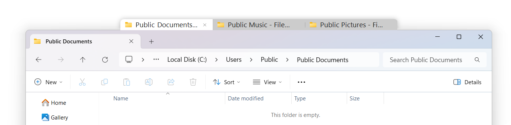
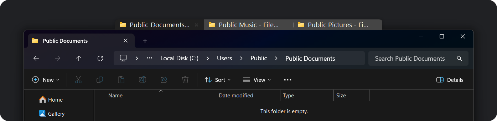
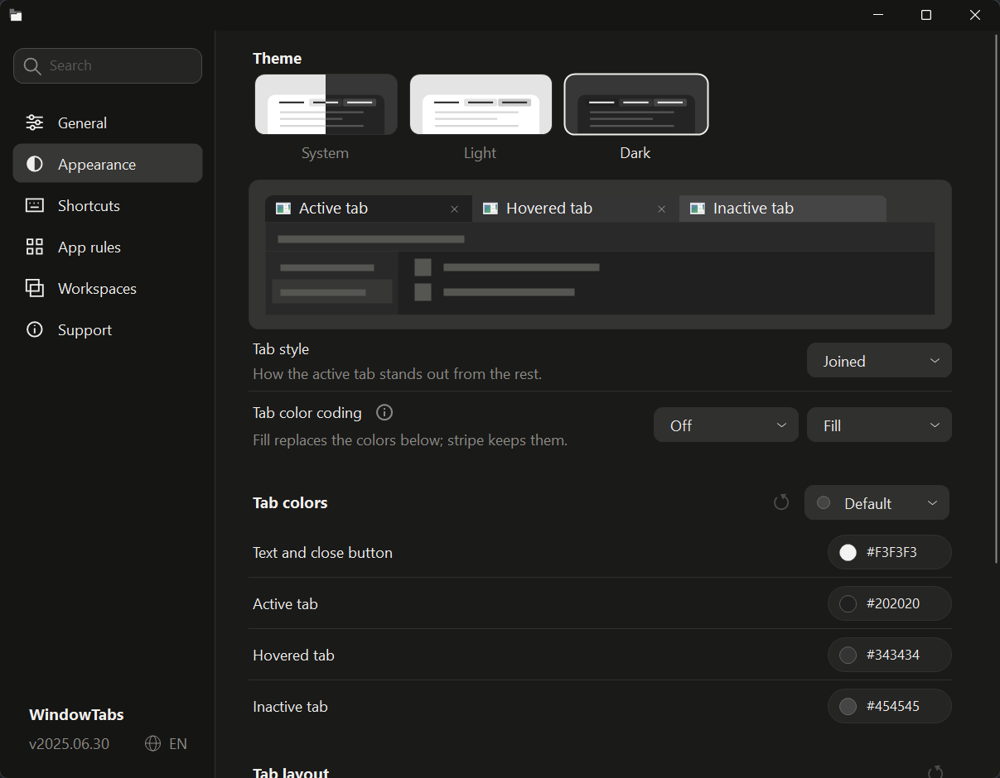

# WindowTabs

Browser-style tabs for your desktop windows. Group windows from any apps and switch
between them with a click or a shortcut.

[](https://github.com/leafOfTree/WindowTabs/releases)
[](https://github.com/leafOfTree/WindowTabs/actions/workflows/build.yml)

> [!IMPORTANT]
> **v2026.10.25-beta.1 preview**: a command palette (Ctrl + Alt + P) for every command and
> setting, split views within a group, pinned tabs, a tab hover preview, a command line and
> Arabic. [What's changed →](CHANGELOG.md)

<a href="docs/images/light.png"></a>

<a href="docs/images/dark.png"></a>

## Get started

Download `WindowTabs.exe` from
[Releases](https://github.com/leafOfTree/WindowTabs/releases) and run it.
It runs in the system tray.

- **Group windows:** drag a tab onto another window's tab bar. Drag it away to ungroup.
- **Group an app automatically:** right-click its tab → **Enable auto-grouping**.
- **Run any command or change any setting:** press **Ctrl + Alt + P** and type its name
  (see [Command palette](#command-palette-and-command-line)).
- **Settings:** right-click a tab or the tray icon.

Grouped windows move and resize together. Tabs hide on maximized windows; point at
the top edge to show them, or set **Auto-hide tabs** to **Never**.

## Shortcuts

| Action | Default |
| --- | --- |
| Next / previous tab | Ctrl + Alt + → / ← |
| Tab 1–9 | Ctrl + 1–9 (or Alt) |
| Search tabs | Ctrl + Alt + T; Alt + Enter on a window gives it a key of its own |
| New window of the current app | Ctrl + Alt + N |
| Switch tabs with the mouse | Scroll over the tab bar, or Shift + scroll over the window |
| Move the current tab | Ctrl + scroll over the tab bar |
| Close a tab | Ctrl + Alt + W, or middle-click |

Change any shortcut under **Settings → Shortcuts**. If Ctrl/Alt + number conflicts
with an app, turn it off for that app from the tab's right-click menu.

**Optional, off by default:** switch on hover, a picture of a tab's window when the pointer
rests on it, a leader key to pick tabs by letter (Alt + F, then the key on the tab), automatic
tab colors, and an Alt+Tab replacement.

Drag files onto a tab and pause to bring that window forward. On a **File Explorer**
tab, let go to drop them into its folder as Explorer would: Ctrl copies, Shift moves,
right-drag asks, and **Ctrl + Z** in Explorer undoes it.

## Features

- **Appearance:** light, dark or follow Windows; Joined, Folder or Floating tabs;
  per-tab or per-app colors.
- **Pinned tabs:** right-click a tab → **Pin** to keep it at the front of its group, out of
  reach of **Close others** and **Close all**, across restarts.
- **App rules:** choose which running apps get tabs and which group automatically.
  Under **Groups across apps**, create named groups so windows of different apps join
  one group. Groups made by dragging tabs are remembered and listed there too.
- **Split view:** show two or more of a group's windows side by side or stacked, as in a
  browser or editor. Right-click a tab → **Split view** and pick a window for each side, or
  drag a tab to a window's edge. Drag the bar between the panes to resize them, right-click
  it to swap, equalize, switch direction or end the split. Shortcuts for a window on the right
  or below and for moving the focus between panes are under **Settings → Shortcuts**, unset by
  default.
- **Workspaces:** save groups and window positions, then restore them onto open windows;
  apps that are not running can be launched and their windows restored. Shortcuts to save
  one and to restore the last saved or restored one are under **Settings → Shortcuts**,
  unset by default.
- **Taskbar:** optionally combine each group into one taskbar button, which shows every
  app in the group.
- **Languages:** English, 中文, 日本語.

<a href="docs/images/settings.png"></a>

## Command palette and command line

**Ctrl + Alt + P** opens the command palette: type a command's name and press Enter.
Every tab menu action, split view command, workspace command and setting is there,
with its shortcut beside it. A setting that is on or off shows a switch and is turned in
place; a choice is picked from its list, a size typed and saved as you type, a colour picked,
and anything else opens the settings window on it. **Restore workspace…** lists the saved
workspaces. Alt + Enter on an action sets its shortcut, as **Settings → Shortcuts** does; a
setting's shortcut opens the palette on its choices or its box. The window search (**Ctrl + Alt + T**) is a box
of its own, over the group's tabs or every window.

Searching works the same in both boxes:

- Type words in any order; each can be part of a name, an app or a word a command is known
  by, so `color tab` finds **Tab color…** and `merge` finds **Group this app**.
- Leave out the spaces, or type the first letters of the words: `movedown` or `md` finds
  **Move down the list**. These come after rows that have the words themselves.
- Type a shortcut, starting with its modifier or function key, such as `ctrl+alt+t` or `f5`,
  to see which command or window has it.
- The last search and recently used actions come first.
- **↑ / ↓** and **Page Up / Page Down** move, **Enter** runs, **Esc** goes back or closes,
  **Tab** goes round the window search's scopes, **Ctrl + U** clears what is typed and
  **Ctrl + Backspace** deletes a word.

The same commands run from a command line, in the running WindowTabs:

```bash
WindowTabs.exe --command next-tab
WindowTabs.exe --command tab-color Blue
WindowTabs.exe --workspace "Project A"
WindowTabs.exe --group "C:\Program Files\App\app.exe" notepad.exe
WindowTabs.exe --commands
```

`--group` starts the programs and puts the windows they open into one group, and
`--workspace` restores a saved workspace; either also starts WindowTabs when it is not
running. `--commands` lists every command with its id.

## Settings and updates

Settings save automatically to `%AppData%\WindowTabs\WindowTabsSettings.json`.
For portable use, put that file next to `WindowTabs.exe`.
Export, import and reset are under **Settings → Support**.

To update, exit WindowTabs from the tray and replace the exe. Settings are kept.

## Troubleshooting

- **No tabs on a window?** Check **Settings → App rules**. Dialogs don't get tabs.
- **Odd behavior after upgrading?** **Settings → Support → Reset to defaults**
  (your old settings are backed up first).
- **Run as administrator?** Not needed and not recommended. Windows blocks some
  input between admin and normal windows, and groups of normal windows keep a
  taskbar button each even with **Combine taskbar icons** on; the group's tab menu
  says why.
- **Dropping files on a tab does nothing?** Windows blocks dragging from an app into
  one running as administrator.

Still stuck? [Open an issue](https://github.com/leafOfTree/WindowTabs/issues) and paste
the troubleshooting report from **Settings → Support**. It leaves out window titles
and paths.

## Development

### Build and run

WindowTabs is an F# WinForms app on .NET Framework 4.8, with a small C# project for
Win32 interop. To build on Windows 10 or 11:

**1. Install the tools**

- [.NET 10.0 SDK](https://dotnet.microsoft.com/en-us/download/dotnet/10.0): choose the Windows SDK installer (usually **x64**).
- [.NET Framework 4.8 Developer Pack](https://dotnet.microsoft.com/en-us/download/dotnet-framework/net48): the runtime alone is not enough to build.

**2. Download, build and run**

Open a new **PowerShell** window in the folder where you want to keep the source:

```bash
git clone https://github.com/leafOfTree/WindowTabs
cd WindowTabs
dotnet build WindowTabs.sln                 # Debug: WtProgram\bin\Debug\WindowTabs.exe
dotnet build WindowTabs.sln -c Release      # Release: WtProgram\bin\Release\WindowTabs.exe (single exe)
```

The first build downloads NuGet dependencies and needs internet access. Run the
generated exe to start WindowTabs in the system tray; exit it before rebuilding,
as the running exe locks the output. If `dotnet` is not found, reopen PowerShell
after installation.

**Alternatively, use Visual Studio**

Install [Visual Studio 2026](https://visualstudio.microsoft.com/downloads/), select
the **.NET desktop development** workload, and keep its default recommended
components. Open `WindowTabs.sln`, set `WtProgram` as the startup project, and press
**F5**.

AI-assisted contributions are welcome. Make sure you
understand and have tested your changes. See [AGENTS.md](AGENTS.md), [architecture](docs/architecture.md) and
[testing](docs/testing.md). 

### Things to know before changing code

- **Threads:** each tab group runs on its own UI thread, and the main thread owns
  settings and window discovery. Calls between them go through the adapters in
  `Shared/Services.fs`. Read [architecture](docs/architecture.md) before touching this.
- **UI text:** every visible string lives in `Shared/Strings.fs` with English, Chinese
  and Japanese. Machine translation is fine for a first draft; native speakers can refine it.
- **Settings:** names, defaults and ranges are declared once in
  `Shared/SettingsCatalog.fs`; the Settings window, search and reset all read from it.
- **DPI and themes:** use logical pixels and scale with `Dpi.scale`; check your UI in
  light, dark and high-contrast modes.


## Code signing policy

Free code signing provided by [SignPath.io](https://about.signpath.io),
certificate by [SignPath Foundation](https://signpath.org).

- Committers and reviewers: [contributors](https://github.com/leafOfTree/WindowTabs/graphs/contributors)
- Approvers: [@leafOfTree](https://github.com/leafOfTree)

Release binaries are built from source by GitHub Actions
([release.yml](.github/workflows/release.yml)), and every signing request is
approved by a maintainer. AI coding agents assist with development, but all
changes are reviewed and merged by a human maintainer.

### Privacy policy

This program will not transfer any information to other networked systems
unless specifically requested by the user or the person installing or
operating it.

## Credits and license

Created by Maurice Flanagan in 2009 ([mauricef/WindowTabs](https://github.com/mauricef/WindowTabs)),
continued by [redgis](https://github.com/redgis/WindowTabs) and
[payaneco](https://github.com/payaneco/WindowTabs). [MIT license](LICENSE).
